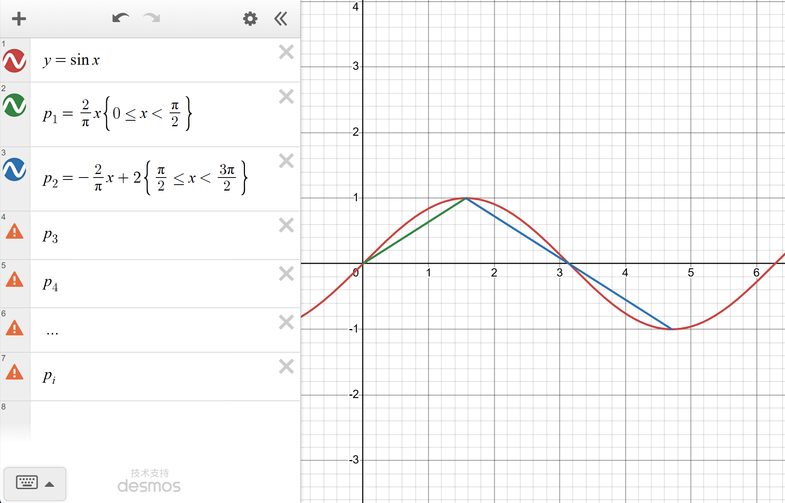
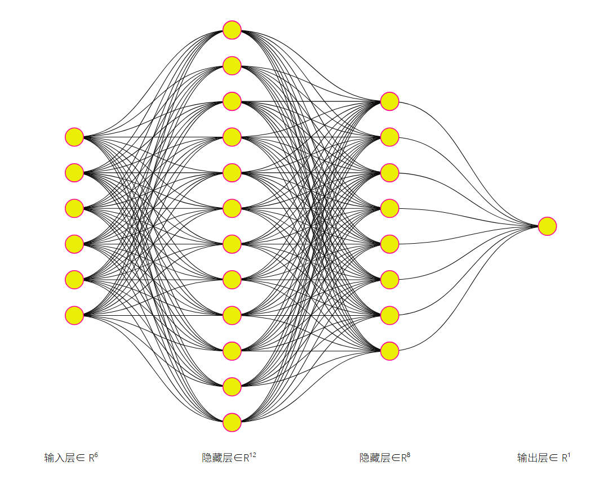
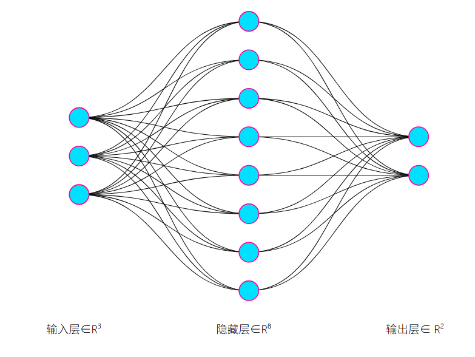
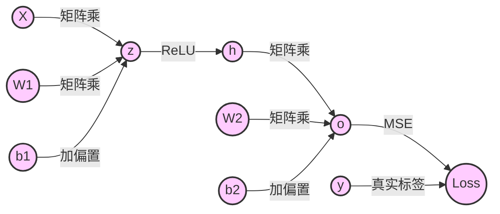
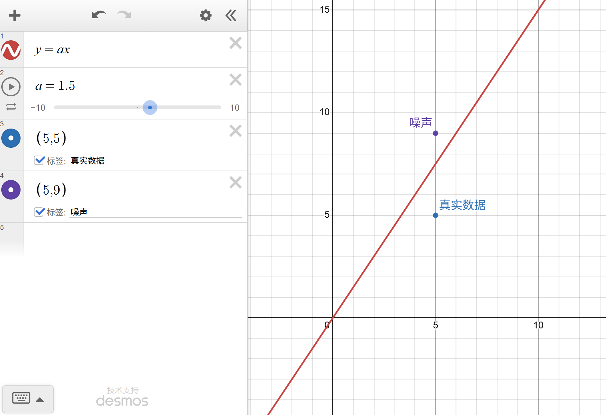
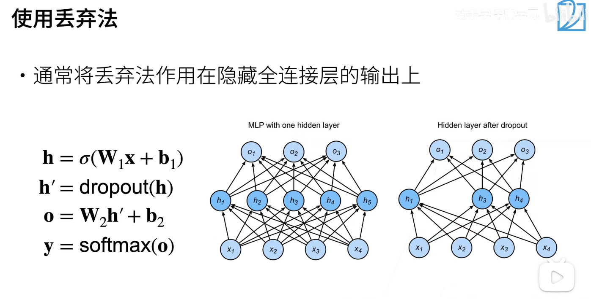

# MLP 章节梳理

这份梳理按"能力 → 代价"的顺序走：先讲 MLP 怎么获得拟合非线性函数的能力（一），再讲怎么控制它的容量、别把噪声也学进去（二），最后讲模型变深以后必然遇到的数值问题（三）。

## 一、MLP 基础

### 1.1 引入：用"线性"的东西拼一条曲线

先提一个问题：**如何拟合一个非线性问题？** 单纯的线性模型（一条直线）显然做不到。

一个有意思的猜想：假设存在函数 $y=\sin(x)$，我们能不能用尽可能 "线性" 的方式去表示它？

**图 1**：$y=\sin(x)$ 与它的分段线性近似——$p_1,p_2,\dots$ 是一段段直线，拼起来就能盖住曲线[^1]。

答案是能——把区间切碎，每一小段都用一条直线顶上：

$$
\begin{cases}
y_1=\dfrac{2}{\pi}x & x\in(0,\dfrac{\pi}{2})\\
y_2=-\dfrac{2}{\pi}x+2 & x\in(\dfrac{\pi}{2},\pi)\\
\cdots
\end{cases}
$$

这是一个分段函数。如果我们可以 "折叠" 模型……

**数学原理：通用近似定理**。理论上，一个包含至少一层隐藏层的 MLP，只要隐藏神经元数量足够多，便可以在闭区间上以任意精度逼近任意连续函数。对应到代码层面，我们需要隐藏层——依靠隐藏层来 "折叠" 模型，从而使其能够拟合任意函数。

**为什么"加深"本身不够用**。D2L 从一个具体的失败案例讲起：softmax 回归本质上是**仿射变换**（线性变换 + 平移），决策边界永远是直线或超平面，像异或（XOR）这样简单的问题都分不开。而把一个仿射变换套在另一个仿射变换上，得到的仍然是仿射变换：

$$
\mathbf{o}=\mathbf{W}_2\left(\mathbf{W}_1\mathbf{x}+\mathbf{b}_1\right)+\mathbf{b}_2
=\left(\mathbf{W}_2\mathbf{W}_1\right)\mathbf{x}+\left(\mathbf{W}_2\mathbf{b}_1+\mathbf{b}_2\right)
=\mathbf{W}\mathbf{x}+\mathbf{b}
$$

**所以多层的意义必须建立在逐元素非线性上**。加上隐藏层和激活函数之后，模型才真正变成：

$$
\mathbf{H}=\phi\left(\mathbf{X}\mathbf{W}^{(1)}+\mathbf{b}^{(1)}\right), \qquad
\mathbf{O}=\mathbf{H}\mathbf{W}^{(2)}+\mathbf{b}^{(2)}
$$

其中 $\mathbf{X}\in\mathbb{R}^{n\times d}$ 是一批 $n$ 个样本，$\mathbf{W}^{(1)}\in\mathbb{R}^{d\times h}$、$\mathbf{b}^{(1)}\in\mathbb{R}^{1\times h}$、$\mathbf{W}^{(2)}\in\mathbb{R}^{h\times q}$、$\mathbf{b}^{(2)}\in\mathbb{R}^{1\times q}$。隐藏单元数 $h$ 就是**宽度**，是需要我们选的超参数。

**回到 $\sin(x)$ 这个例子**。分段线性近似的本质，是用很多段直线"拼"出一条曲线，段数越多、折点越密，误差越小。而一个隐藏层含 $m$ 个 ReLU 单元的网络，本身就是一个最多 $m+1$ 段的分段线性函数，隐藏单元扮演的正是**可学习的折点**：

$$
f(x)=f(c_0)+s_0\left(x-c_0\right)+\sum_{i=1}^{m}\left(s_i-s_{i-1}\right)\operatorname{ReLU}\left(x-c_i\right)
$$

其中 $c_1<\cdots<c_m$ 是折点，$s_i$ 是第 $i$ 段的斜率（$s_0$ 是最左边一段）。把上面那两段代进去，斜率从 $\frac{2}{\pi}$ 变到 $-\frac{2}{\pi}$，写出来正好是

$$
f(x)=\frac{2}{\pi}x-\frac{4}{\pi}\operatorname{ReLU}\left(x-\frac{\pi}{2}\right)
$$

这也是原笔记里说的"折叠"：**每多一个 ReLU 单元就多一次折**，折得足够多、足够细，就能拼出任意形状的曲线。想要更细的分段，就得加宽——这就是"宽度"与"容量"最直接的联系。

**通用近似定理的数学形式**：对紧集 $K\subset\mathbb{R}^{d}$ 上的任意连续函数 $f$ 和任意 $\epsilon>0$，都存在隐藏单元数 $m$ 及相应参数，使得

$$
\sup_{\mathbf{x}\in K}\left|f(\mathbf{x})-\sum_{i=1}^{m}c_i\,\sigma\left(\mathbf{a}_i^{\top}\mathbf{x}+b_i\right)\right|<\epsilon
$$

要注意定理**只保证"存在"**：既不保证梯度下降一定能找到这组参数，也不告诉我们 $m$ 该取多大、需要多少数据。所以"理论上能拟合任意函数"和"实际能训好"是两件事，后者正是后面正则化、初始化、数值稳定性要解决的问题。

### 1.2 激活函数

**要点**：如果多层网络只是线性变换的堆叠，那么多层网络等价于单层线性网络，无法获得非线性表达能力。激活函数为网络引入非线性变换，是 MLP 能够拟合复杂非线性函数的核心。常用激活函数：ReLU、Sigmoid、Tanh，其中 ReLU 是隐藏层最常选用的。

**为什么非有不可**：若 $\phi$ 取恒等映射，上面两层复合又塌回 $\mathbf{W}_2\mathbf{W}_1$，容量与单层线性模型完全一样。激活函数**按元素作用、不改变张量形状**，只负责把线性变换"掰弯"。

**三种常用激活函数及其导数**（D2L 4.1.2）：

$$
\operatorname{ReLU}(x)=\max(x,0), \qquad
\frac{d}{dx}\operatorname{ReLU}(x)=
\begin{cases}
1, & x>0\\
0, & x<0
\end{cases}
$$

$$
\operatorname{sigmoid}(x)=\frac{1}{1+\exp(-x)}, \qquad
\frac{d}{dx}\operatorname{sigmoid}(x)=\operatorname{sigmoid}(x)\left(1-\operatorname{sigmoid}(x)\right)
$$

$$
\tanh(x)=\frac{1-\exp(-2x)}{1+\exp(-2x)}=2\operatorname{sigmoid}(2x)-1, \qquad
\frac{d}{dx}\tanh(x)=1-\tanh^{2}(x)
$$

**ReLU 的变体：LeakyReLU**（d2l 正文没展开，属于补丁）。ReLU 在负半轴把一切压平成 0，一个神经元如果"跑偏"到长期待在负半轴，就再也不会被激活，梯度恒为 0，从此不再学习——这就是死神经元。LeakyReLU 的思路很简单：负半轴别压平，**漏出**一个很小的斜率 $\alpha$：

$$
\operatorname{LeakyReLU}(x)=
\begin{cases}
x, & x>0\\
\alpha x, & x\le 0
\end{cases}
\qquad\Longrightarrow\qquad
\frac{d}{dx}\operatorname{LeakyReLU}(x)=
\begin{cases}
1, & x>0\\
\alpha, & x\le 0
\end{cases}
$$

$\alpha$ 一般取 $0.01$ 或 $0.1$ 这样的小常数。负半轴的梯度不再是 0，神经元就算暂时"掉队"，也还有机会被一点点拽回来。代价是多了一个超参数 $\alpha$，实测也不一定比 ReLU 好，所以它通常是备选项，而不是默认项。

**怎么选**：

- **ReLU**：只做一次比较，没有指数运算；正半轴导数恒为 1，不饱和。隐藏层的**默认选择**，缺点是可能出现死神经元。
- **Sigmoid**：把输出压到 $(0,1)$，两端导数趋于 0（最大只有 $\frac{1}{4}$），输出也不是零中心的。现在主要用在**二分类输出层**。
- **Tanh**：sigmoid 的零中心版本，输出在 $(-1,1)$。做隐藏层比 sigmoid 好用，但同样会饱和。
- **LeakyReLU**：ReLU 的"漏一点"版本，负半轴留一个很小的斜率 $\alpha$，专治**死神经元**；多一个超参数，默认仍用 ReLU。

**小细节**：ReLU 在 $x=0$ 处不可导，框架里约定导数取 0，实际训练不受影响；sigmoid、tanh 的饱和性，正是第三节"梯度消失"的主要来源。

### 1.3 MLP 结构

**结构**：MLP 由输入层、一层或者多层隐藏层、输出层组成，层与层之间为全连接。输入层接收原始特征；隐藏层经过线性变换 + 激活函数完成特征提取；输出层输出模型预测结果，分类任务一般搭配 Softmax，回归任务无额外激活。

**图 2**：一个简单的 MLP——输入 $6$ 维，两个隐藏层分别有 $12$、$8$ 个单元，输出 $1$ 维[^2]。

**写成递推式**：$L$ 层 MLP 就是反复做"仿射变换 + 激活"，其中 $\mathbf{H}^{(0)}=\mathbf{X}$：

$$
\mathbf{H}^{(l)}=\phi^{(l)}\left(\mathbf{H}^{(l-1)}\mathbf{W}^{(l)}+\mathbf{b}^{(l)}\right),\quad l=1,\dots,L-1,
\qquad
\mathbf{O}=\mathbf{H}^{(L-1)}\mathbf{W}^{(L)}+\mathbf{b}^{(L)}
$$

最后一层通常不再接激活，而是把 $\mathbf{O}$ 直接交给损失：**回归**用平方损失，**多分类**先过 softmax 再算交叉熵。

**参数量**：宽度从 $n_{l-1}$ 到 $n_l$ 的第 $l$ 层，有 $n_{l-1}n_l$ 个权重和 $n_l$ 个偏置：

$$
N_{\mathrm{param}}=\sum_{l=1}^{L}\left(n_{l-1}n_l+n_l\right)
$$

例如 $784\to256\to10$ 的网络共有 $784\times256+256+256\times10+10=203{,}530$ 个参数，一个隐藏层就吃掉了绝大部分，这也是"**宽度是最花钱的超参数**"的原因。

**"全连接"的含义**：每个输出单元都与上一层的全部单元相连，层内计算就是一次矩阵乘法，落到 GPU 上就是高度优化的 GEMM。所以 MLP 是计算最规整、最容易并行的结构，也是后面 CNN、Transformer 里"前馈层"的原型。

**表示学习的直观**：浅层把原始特征组合成边缘、纹理这类低级模式，深层再把这些模式组合成部件乃至物体；隐藏层的意义就是学到一个**更好用的表示**，让最后那层线性分类器够用。

### 1.4 重要的超参数：深度、宽度等

**要点**：MLP 最核心的结构超参数是**深度（隐藏层的层数）**和**宽度（单个隐藏层神经元个数）**。除此之外还包括激活函数种类、是否添加 Dropout、BatchNorm、是否开启偏置 bias 等。深度与宽度共同直接决定网络的理论模型容量。

**深度与宽度的分工**：宽度决定"一次能看多少种组合"，深度决定"能叠几层抽象"。理论上，宽度固定、只增加深度的 ReLU 网络能划分出的线性区域数可以随深度**指数增长**，而单隐藏层只随宽度线性增长，这就是"深"在表达效率上的优势。

**代价**：深度越深，梯度要穿过越长的连乘链，越难训练；宽度带来的主要问题是参数和显存。所以实际调参一般是先定一个不太深的网络，把宽度调到能拟合训练集，再逐步加深。

**分三类列清楚**：

- **结构类**：深度、宽度、激活函数、是否使用偏置。
- **正则类**：权重衰减系数 $\lambda$、Dropout 概率 $p$。
- **训练类**：学习率、批大小、迭代轮数、初始化方式、是否使用 BatchNorm。

挑法都一样：**用验证集挑，别拿测试集挑**。

### 1.5 模型容量

**要点**：模型容量代表模型拟合各类复杂函数的能力。深度越深、每层宽度越大，网络参数越多，模型容量越高。容量不是越大越好，需要和数据集本身内在复杂度相匹配。

**D2L 的定义**：模型容量（capacity）指模型拟合各种函数的能力。容量太低，连训练集都拟合不好，表现为**欠拟合**；容量太高，则可能把训练集里的噪声一起背下来，表现为**过拟合**。

**训练误差与泛化误差**：

$$
L_{\mathrm{train}}=\frac{1}{n}\sum_{i=1}^{n}l\left(\mathbf{x}_i,y_i,f(\mathbf{x}_i)\right),
\qquad
L_{\mathrm{gen}}=\mathbb{E}_{(\mathbf{x},y)\sim P}\left[l\left(\mathbf{x},y,f(\mathbf{x})\right)\right]
$$

其中 $L_{\mathrm{train}}$ 是**训练误差**，可以直接在训练集上算；$L_{\mathrm{gen}}$ 是**泛化误差**，要对真实分布 $P$ 求期望，只能用验证集估计。两者之差就是**泛化 gap**。

**容量的 U 形曲线**：容量增大，训练误差单调下降；泛化误差先降后升。最优容量就在两者之间，也就是"刚好匹配数据内在复杂度"的那个位置。

**影响容量的不只是参数个数**：参数的取值范围同样算数。同样的结构，用权重衰减排把权重压在 0 附近，**有效容量**就下降了，能表达的函数变少了。

**数据量也在决定容量**：训练样本越少越容易过拟合；当样本数少于参数个数时，模型原则上可以把训练集完全记住。所以"容量是否过大"必须**相对数据量**来谈。

**模型选择**：真实泛化误差算不出来，于是留出验证集（数据紧张时用 $K$ 折交叉验证）来估计，用**验证误差**挑超参数，而不是用训练误差。

### 1.6 底层计算原理：计算图、前向与反向传播

**要点**：MLP 的训练依靠梯度下降，梯度的求取依托计算图、前向传播与反向传播。

#### 前向传播

从输入出发，顺着网络依次完成每层的矩阵运算、激活运算，最终得到模型预测值，结合标签计算损失函数的值。前向传播过程中框架会记录全部运算操作，自动构建**计算图**。

写成公式，两层网络 + L2 罚项的版本（D2L 4.7）是：

$$
\begin{aligned}
\mathbf{z} &= \mathbf{W}^{(1)}\mathbf{x}, &\quad
\mathbf{h} &= \phi(\mathbf{z}), &\quad
\mathbf{o} &= \mathbf{W}^{(2)}\mathbf{h},\\
L &= l(\mathbf{o},y), &\quad
s &= \frac{\lambda}{2}\left(\left\|\mathbf{W}^{(1)}\right\|_F^{2}+\left\|\mathbf{W}^{(2)}\right\|_F^{2}\right), &\quad
J &= L+s
\end{aligned}
$$

前向时不只要算出 $J$，还要把 $\mathbf{z},\mathbf{h},\mathbf{o}$ 这些**中间变量**存下来，反向时会全部用到。

#### 反向传播

从损失函数开始，沿着计算图逆向使用链式法则，求损失对网络中每一个权重参数的梯度。优化器拿到梯度，按照梯度下降策略更新权重参数，迭代缩小损失。

从 $J$ 出发逆序求导：

$$
\begin{aligned}
\frac{\partial J}{\partial \mathbf{W}^{(2)}} &= \frac{\partial J}{\partial \mathbf{o}}\mathbf{h}^{\top}+\lambda\mathbf{W}^{(2)}, &\quad
\frac{\partial J}{\partial \mathbf{h}} &= \frac{\partial J}{\partial \mathbf{o}}\left(\mathbf{W}^{(2)}\right)^{\top},\\
\frac{\partial J}{\partial \mathbf{z}} &= \frac{\partial J}{\partial \mathbf{h}}\odot\phi'(\mathbf{z}), &\quad
\frac{\partial J}{\partial \mathbf{W}^{(1)}} &= \frac{\partial J}{\partial \mathbf{z}}\mathbf{x}^{\top}
\end{aligned}
$$

其中 $\odot$ 表示逐元素乘。d2l 用 $\operatorname{prod}(\cdot)$ 统一表示矩阵乘、向量内积和逐元素乘，上面就是把它按具体形状展开的结果。可以看到：每一层只要拿到**上游梯度** $\partial J/\partial\mathbf{h}$，就能同时算出本层的参数梯度和继续往下传的梯度。这就是**反向模式自动微分**的全部逻辑——一次反向，所有参数的梯度都到手。

#### 一个具体例子：3-8-2 网络的计算图

先看网络本身：输入 $3$ 维、隐藏层 $8$ 个单元、输出 $2$ 维。

**图 3**：3-8-2 网络的结构，层与层之间全连接[^3]。

把它展开成计算图，就是下面这样。每个节点是一个张量，每条边标着"对谁做了什么运算"：

图里的几种边值得记一下：

| 边上的标记 | 含义 | 对应公式 |
| :-- | :-- | :-- |
| **矩阵乘** | 矩阵乘法 | $\mathbf{z}=\mathbf{X}\mathbf{W}^{(1)}$、$\mathbf{o}=\mathbf{h}\mathbf{W}^{(2)}$ |
| **加偏置** | 加偏置 | $\mathbf{z}+\mathbf{b}^{(1)}$、$\mathbf{o}+\mathbf{b}^{(2)}$ |
| **ReLU** | 逐元素激活 | $\mathbf{h}=\operatorname{ReLU}(\mathbf{z})$ |
| **MSE** | 均方误差损失 | $L=\frac{1}{n}\sum_i\left(o_i-y_i\right)^2$ |
| **真实标签** | 标签参与算损失 | $y$ |

反向传播时，梯度就沿着这些边**反着走一遍**：先把 $\partial J/\partial\mathbf{o}$ 分给 $\mathbf{W}^{(2)}$ 和 $\mathbf{h}$，再穿过 ReLU 的导数 $\phi'(\cdot)$ 回到 $\mathbf{z}$，最后分到 $\mathbf{W}^{(1)}$ 和 $\mathbf{b}^{(1)}$。每个参数只求一次导、只更新一次——这就是计算图存在的意义。

**代价**：一次反向的计算量约为前向的两倍，但必须保留前向的中间结果，所以训练显存大致随"层数 × 每层激活大小"增长，再大就要靠梯度检查点之类的技巧。

**参数更新**：拿到梯度后，优化器做的就是

$$
\mathbf{W}\leftarrow\mathbf{W}-\eta\,\frac{\partial J}{\partial \mathbf{W}}
$$

小批量训练时用的是批内样本梯度的平均 $\frac{1}{|\mathcal{B}|}\sum_{i\in\mathcal{B}}\nabla l_i$，所以叫**随机梯度下降**。

### 1.7 新的矛盾：容量选大了，怎么把有效容量压下去？

**理论上**，我们需要一组 "完美" 的超参数，让模型容量刚好匹配数据集的真实复杂度，既不会欠拟合，也不会过拟合。但现实往往差强人意，并且我们很难清楚知道数据集的真实复杂度。大部分场景下我们会选用更大的模型容量；大容量模型会带来过拟合或者欠拟合的风险。

**补充**：欠拟合一般是模型容量不足，无法学到数据内部规律；过拟合是模型学到了训练集里面独有的随机噪声，在验证集上误差很高。

**先判断处在哪一边**：用训练误差和验证误差一起看。

| 训练误差 | 验证误差 | 结论 |
| :-- | :-- | :-- |
| 高 | 高 | **欠拟合**：容量不足，或训练不够充分 |
| 低 | 明显更高 | **过拟合**：容量超过了数据复杂度 |
| 低 | 低且接近 | 差不多到位了 |

**对应的处方**：

- **欠拟合**：加容量——加宽、加深、训练更久、减少正则。
- **过拟合**：降有效容量或加数据——数据增强、权重衰减、Dropout、早停。

**数学视角**（偏差-方差分解）：对平方损失，

$$
\mathbb{E}\left[\left(y-f(\mathbf{x})\right)^{2}\right]
=\sigma_{\mathrm{noise}}^{2}
+\left(\mathbb{E}\left[f(\mathbf{x})\right]-f^{*}(\mathbf{x})\right)^{2}
+\operatorname{Var}\left[f(\mathbf{x})\right]
$$

三项分别是**不可约噪声**、**偏差的平方**、**方差**。欠拟合对应偏差大（假设空间不够"近似"），过拟合对应方差大（对有限训练集太敏感）；容量、正则化和数据量，其实都在调这两项之间的平衡。

**于是问题变成**：网络结构已经定下来了，还能不能**不动结构**、只在损失函数或训练流程上加点"限制"，把它的**有效容量**收回来？能——这就是下一节要讲的**正则化**。

---

## 二、正则化

### 2.1 正则化介绍

**先回答上一节留下的问题**：结构不动，怎么把有效容量压下去？——靠**正则化**。

**D2L 的定义**：正则化是一类方法，通过向模型施加约束，降低模型的有效容量，以此缓解过拟合。正则化不会改变网络的理论结构，而是在损失或者训练流程上增加限制，抑制网络去拟合训练集噪声。注意：正则化主要解决过拟合，**无法改善欠拟合**。

**两类做法**：

- **在损失上加惩罚项**：权重衰退。
- **在训练流程上加约束**：Dropout 随机丢弃、数据增强、早停。

d2l 把两者都算作正则化，因为它们的共同点是**限制模型在训练集上的自由度**。

**统一的数学形式**：

$$
\min_{\mathbf{w}}\;L(\mathbf{w})+\lambda\,\Omega(\mathbf{w})
$$

$\Omega$ 是复杂度惩罚：L2 取 $\Omega(\mathbf{w})=\frac{1}{2}\|\mathbf{w}\|_{2}^{2}$，L1 取 $\|\mathbf{w}\|_{1}$；$\lambda$ 控制正则强度，$\lambda=0$ 时退化为原来的经验风险最小化。

**约束视角**：L2 罚项等价于在约束 $\|\mathbf{w}\|_{2}\le C$ 下最小化 $L$（$C$ 与 $\lambda$ 一一对应），也就是把解限制在一个球里，不允许权重长得太大。**权重小，函数对输入的小扰动就不敏感，解更平滑，因此更容易泛化。**

**边界要清楚**：正则化降低的是**有效容量**，网络结构一点没变；它主要对付过拟合，对欠拟合没有帮助——欠拟合时应该**减少**正则，而不是增加。

### 2.2 权重衰退（L2 正则）

**它是什么**：权重衰退（Weight Decay）也就是 L2 正则化，在原始损失函数上增加权重参数的 L2 范数惩罚项：

$$
L_{total}=L_{loss}+\frac{\lambda}{2}\Vert W\Vert_2^2
$$

其中 $\lambda$ 是权重衰退超参数。惩罚项加入计算图参与反向传播，权重更新的时候会额外把权重向 0 收缩，避免权重取值过大，迫使模型得到更加平滑的解。推理阶段没有额外开销。

**先说人话：为什么要把权重"拽小"**。看下面这张图。

**图 4**：$y=ax$ 在拟合一个混了噪声的数据集——真实点在 $(5,5)$，噪声点在 $(5,9)$[^4]。

真实数据大概落在 $(5,5)$ 附近，可训练集里混进了一个噪声点 $(5,9)$。模型为了把这个"离谱"的点也照顾到，只能把直线掰得更陡——斜率 $a$ 被拉大（图里是 $a=1.5$；如果只拟合真实数据，$a=1$ 就够了）。

**斜率大 = 权重绝对值大 = 函数变化剧烈**。这样的模型在训练集上看着还行，一旦测试点稍微偏一点，预测就会翻得很厉害。

权重衰退干的事很朴素：**每次更新前，先把权重乘上一个略小于 1 的系数，让它自己往 0 缩一点**。这样模型就不敢用"特别陡"的斜率去迁就个别噪声点，拟合出来的线更平缓，泛化更好。所谓"衰退"，说的就是权重每一步都在自己变小。

**为什么叫"衰退"**：对损失求梯度得 $\nabla L_{total}=\nabla L_{loss}+\lambda\mathbf{w}$，代入梯度下降：

$$
\mathbf{w}\leftarrow\mathbf{w}-\eta\left(\nabla L_{loss}+\lambda\mathbf{w}\right)
=\left(1-\eta\lambda\right)\mathbf{w}-\eta\nabla L_{loss}
$$

每一步都先把权重乘上 $(1-\eta\lambda)$，再沿原梯度走一步，权重被持续往回拉——所以叫**权重衰退**（d2l 里也写作权重衰减，weight decay）。

**闭式解视角**（线性回归）：加上 L2 之后，正规方程变成

$$
\left(\mathbf{X}^{\top}\mathbf{X}+\lambda\mathbf{I}\right)\mathbf{w}=\mathbf{X}^{\top}\mathbf{y}
$$

相当于在协方差矩阵的对角线上加一个正数，既把权重整体压小，也改善了矩阵病态的问题（这就是**岭回归**）。$\lambda\to 0$ 退回最小二乘；$\lambda\to\infty$ 时 $\mathbf{w}\to\mathbf{0}$。

**实践细节**：

- 一般只惩罚权重，不惩罚偏置。
- 惩罚项只在训练时进入计算图，推理阶段没有任何额外开销。
- $\lambda$ 本身也是超参数，要靠验证集挑。

d2l 用高维线性回归的合成数据做过对照：$\lambda=0$ 时训练误差很小而验证误差明显偏大；加大 $\lambda$ 后训练误差上升、验证误差明显下降；$\lambda$ 太大会重新变成欠拟合。

### 2.3 Dropout（丢弃法）

**图 5**：丢弃法作用在隐藏层上——左边是完整的一层（$h_1\sim h_5$ 都参与），右边是丢弃之后只剩 $h_1,h_3,h_4$ 参与这一次前向[^5]。

课上的公式写得很直白：$\mathbf{h}=\sigma(\mathbf{W}_1\mathbf{x}+\mathbf{b}_1)$，$\mathbf{h}'=\operatorname{dropout}(\mathbf{h})$，$\mathbf{o}=\mathbf{W}_2\mathbf{h}'+\mathbf{b}_2$，$\mathbf{y}=\operatorname{softmax}(\mathbf{o})$。也就是说，丢弃法**只动隐藏层的输出**，后面的层拿到的是"缺了几个神经元"的版本。

**D2L 的核心思想**：**只在训练阶段生效**，前向传播的时候，某一层的神经元以指定概率 $p$ 随机被置零屏蔽。被屏蔽的神经元本轮反向传播梯度直接置零，不会更新参数。它打破神经元之间过度的共适应关系，不让少数几个神经元单独记住训练噪声。测试阶段全部神经元启用，一般配套权重缩放。

**到底什么叫"共适应"，为什么把梯度置 0 就能治它？**

先看一个具体场景。隐藏层里两个神经元 $A$ 和 $B$ 慢慢形成了默契：$B$ 专门去认训练集里某个很细的特征（比如某张图角落里的一粒噪点），$A$ 负责在 $B$ 亮起来的时候"补一刀"，两个一起给出正确输出。单看 $A$、$B$，各自学到的都是"半截"信息，凑在一起却对训练集异常好用——于是网络把这条捷径记住了。问题是，这条捷径只对当前这批样本成立，换一批数据就失效。这就是**共适应（co-adaptation）**：神经元之间长出了只服务于当前样本的固定依赖，而不是各自学到通用特征。

丢弃法做的事，就是**每一轮都把这对搭子随机拆一次**：

1. 每次前向，每个神经元都有概率 $p$ 被置零，$B$ 有可能这一轮根本不在。
2. $A$ 拿不到 $B$ 的信息，只能自己把输入里到底有什么想清楚，才可能把损失降下去。
3. 反向传播时，被置零的神经元输出是 $0$，链式法则乘到这个 $0$，它**这一轮**的梯度就是 $0$、参数不更新；下一轮它可能又回来了，接着学。
4. 训练足够久，每个神经元都被逼着"什么都会一点"，固定组合被打散，学到的特征更通用。

注意第 3 点里"梯度为 0"是**临时的**：只在本轮、只对被抽中的神经元。这和 ReLU 死神经元那种输入长期为负、导数恒为 0 的**永久**失效不是一回事——前者是主动的随机扰动，后者是训练事故。

**数学定义**（D2L 4.6）：训练时对隐藏层的每个元素独立地按概率 $p$ 置零，其余元素除以 $1-p$：

$$
h_i'=
\begin{cases}
0, & \text{with probability } p\\
\dfrac{h_i}{1-p}, & \text{otherwise}
\end{cases}
\qquad\Longrightarrow\qquad
\mathbb{E}\left[h_i'\right]=\frac{(1-p)\,h_i}{1-p}=h_i
$$

除以 $1-p$ 是为了让**期望保持不变**，否则训练时只用了一部分神经元、测试时全部打开，输出尺度会突然变大。它的方差是

$$
\operatorname{Var}\left[h_i'\right]=\frac{p}{1-p}\,h_i^{2}
$$

也就是说，丢弃法给每一层的激活注入了一个**乘性的随机噪声**，噪声强度由 $p$ 决定。

**换个角度看：等于在训练一堆子网络**。每次前向相当于从 $2^{m}$ 个子网络里随机抽一个（$m$ 是该层神经元数）来训练一小步，测试时用完整网络去近似这些子网络的**集成**（ensemble）——这其实就是"拆共适应"的另一种说法：单个神经元不敢依赖某个特定同伴，就得自己学出用处。

**缩放放在哪一步**：d2l 采用 inverted dropout，把 $1/(1-p)$ 的缩放放在**训练**阶段，所以测试时直接把整个网络打开就行，不需要再额外缩放；这与"训练时不动、测试时乘 $1-p$"的经典写法数学上等价。用框架实现时记得用 `model.train()` 与 `model.eval()` 切换，否则测试时还会继续随机丢弃。

**常用设置**：

- 一般只对隐藏层丢弃，输出层不丢。
- $p$ 常取 $0.2\sim0.5$，d2l 的例子给两个隐藏层分别设了 0.2 和 0.5。
- $p=0$ 时退化为恒等映射。

**和权重衰退放在一起对比**：

| 方法 | 加在哪 | 训练时做什么 | 推理时 | 主要作用 |
| :-- | :-- | :-- | :-- | :-- |
| 权重衰退 | 损失函数 | 梯度多一项 $\lambda\mathbf{w}$，权重按 $(1-\eta\lambda)$ 收缩 | 完全无额外开销 | 限制权重幅度 |
| Dropout | 隐藏层激活 | 以 $p$ 置零，保留的除以 $1-p$ | 全部打开，不再缩放 | 打断共适应 |

### 2.4 新的问题：网络变深了，梯度还传得回去吗？

**容量这头刚按住，另一头又顶上来**：正则化管的是"别学太多"，可要拟合更复杂的东西，还是得把网络堆深。为了获得足够表达能力，我们搭建更深的 MLP，深度提升之后反向传播链式求导多次相乘，带来深层网络的数值稳定性问题，也就是梯度消失、梯度爆炸；ReLU 激活还会衍生死神经元现象。

**根源**：损失对浅层权重的梯度是一长串雅可比矩阵的**连乘**，深度每加一层就多乘一次。只要这些因子的尺度普遍小于 1 或普遍大于 1，梯度就会指数级衰减或放大，而且它和激活函数、初始化、学习率是耦合在一起的。

顺带还会遇到几个麻烦：

- 前向传播中激活值的数值范围随层数漂移。
- ReLU 的死神经元让一部分梯度长期为 0。
- 用 float16 训练时更容易上溢和下溢。

**所以下一节只回答一个问题**：一个几十层的网络，梯度从损失一路乘回第一层，还能保持在正常量级上吗？——这就是**数值稳定性与参数初始化**。

---

## 三、数值稳定性

### 3.1 梯度爆炸和梯度消失

**上一节的问题在这里有答案**：深网络里的梯度到底是稳住、还是爆掉、还是悄悄消失，取决于连乘因子的尺度。

**D2L 的定义**：多层网络反向传播时，梯度等于多层导数的连乘。当层数很多时，如果每层导数小于 1，多次相乘梯度指数级衰减，浅层权重几乎不再更新，也就是**梯度消失**；如果每层导数大于 1，连乘之后梯度数值急剧变大，参数更新剧烈震荡、训练发散，就是**梯度爆炸**。

**拓展**：ReLU 死神经元是梯度消失的局部特例，当 ReLU 输入长期小于 0，导数恒等于 0，该神经元梯度永久为 0，不再参与学习。

**D2L 的切入点是上溢与下溢**：深度网络里最常见的数值问题是浮点的**上溢**（overflow，变成 `inf`）和**下溢**（underflow，变成 0）。以 softmax 为例，

$$
\hat{y}_j=\frac{\exp(o_j)}{\sum_{k}\exp(o_k)}
$$

$o_j$ 很大时 $\exp(o_j)$ 上溢；所有 $o_k$ 都很小（很负）时分子分母一起下溢成 0，出现 $0/0$，也就是 `NaN`。标准处理是分子分母同除 $\exp(m)$，其中 $m=\max_k o_k$：

$$
\hat{y}_j=\frac{\exp\left(o_j-m\right)}{\sum_{k}\exp\left(o_k-m\right)}
$$

结果完全不变，但指数上的数都 $\le 0$，既不会上溢，也不会所有项都是 0。这一招常被称作 **log-sum-exp 技巧**。

**梯度的连乘公式**：对 $L$ 层网络，损失 $\mathcal{L}$ 对第 $l$ 层权重的梯度可以写成

$$
\frac{\partial\mathcal{L}}{\partial\mathbf{W}^{(l)}}
=\frac{\partial\mathcal{L}}{\partial\mathbf{h}^{(L)}}
\left(\prod_{i=l}^{L-1}\frac{\partial\mathbf{h}^{(i+1)}}{\partial\mathbf{h}^{(i)}}\right)
\frac{\partial\mathbf{h}^{(l)}}{\partial\mathbf{W}^{(l)}}
$$

中间那一串矩阵乘积，就是全部问题的来源：

- 因子普遍**小于 1**：梯度指数衰减，即**梯度消失**。
- 因子普遍**大于 1**：梯度指数增长，即**梯度爆炸**。

**量级感受**：sigmoid 的导数满足 $\sigma'(x)\le\frac{1}{4}$，若每层都接近饱和，$L$ 层之后梯度上界约为 $4^{-L}$，10 层就只剩 $10^{-6}$ 量级；反过来，如果每层把信号放大 1.5 倍，10 层后就是 $1.5^{10}\approx57$ 倍。**指数，就是深层网络难训的全部原因。**

**后果**：

- **梯度消失**：浅层几乎不更新，网络退化成"只有最后几层在学习"。
- **梯度爆炸**：参数更新过猛，损失出现 `inf`、`NaN`，训练直接发散。
- **死神经元**：ReLU 输入长期小于 0，导数恒为 0，是梯度消失的极端局部情形。

**对策**：

- 换用 ReLU 这类不饱和激活；担心死神经元就换 **LeakyReLU**（见 1.2）。
- 用 **Xavier 或 He 初始化**，让每层方差保持稳定。
- 用 **BatchNorm** 把每层输入拉回稳定分布。
- 用**残差连接**给梯度留一条"捷径"。
- 用**梯度裁剪**限制单步幅度：

$$
\mathbf{g}\leftarrow\min\left(1,\frac{\theta}{\|\mathbf{g}\|}\right)\mathbf{g}
$$

其中 $\theta$ 是裁剪阈值。再加上适当调小学习率、调试阶段用 float64。

### 3.2 参数初始化（Xavier 初始化）

**为什么和数值稳定性放一起**：D2L 把"数值稳定性"和"模型初始化"放在同一节讲。既然梯度是连乘，那只要让每一层的输入、输出方差大致保持不变，连乘因子的尺度就被钉在 1 附近，梯度消失和爆炸可以一起缓解。而**初始化是最便宜的那一步**。

**方差分析**：设权重 $W_{ij}\sim\mathcal{N}(0,\sigma^{2})$、偏置为 0、输入各分量独立且均值为 0，则前向传播有

$$
\operatorname{Var}\left[h_i^{(l)}\right]=n_{in}\,\sigma^{2}\,\operatorname{Var}\left[h_j^{(l-1)}\right]
$$

要让方差在层间保持不变，需要 $n_{in}\sigma^{2}=1$；反向传播时梯度也要再乘一次同形状的矩阵，要让梯度方差不缩水，还需要 $n_{out}\sigma^{2}=1$。两个条件通常不能同时满足，于是取折中：

$$
\sigma^{2}=\frac{2}{n_{in}+n_{out}}
\qquad\Longrightarrow\qquad
W_{ij}\sim\mathcal{N}\left(0,\frac{2}{n_{in}+n_{out}}\right)
$$

这就是 **Xavier 初始化**（Glorot 初始化）。它假设激活函数在 0 附近近似线性，tanh 和 sigmoid 满足这个条件；对 ReLU 更常用的是 **He 初始化**，方差取 $\frac{2}{n_{in}}$。

**实践**：

- PyTorch 的 `nn.Linear` 默认按均匀分布初始化，深网络里未必合适，层数较多时最好显式做 Xavier 或 He 初始化。
- 偏置一般初始化为 0。
- 初始化只影响起点、不改变模型容量，但会明显影响**能不能训起来**。

[^1]: 图 1 来源：自己用 **Desmos** 画的，$p_1,p_2,\dots$ 逐段把 $\sin x$ 盖住。
[^2]: 图 2 来源：**NN-SVG**（http://alexlenail.me/NN-SVG/）的电脑截图。
[^3]: 图 3 来源：同上，**NN-SVG** 截图。
[^4]: 图 4 来源：**Desmos**（https://www.desmos.com/calculator）截图。
[^5]: 图 5 来源：**李沐《动手学深度学习》B 站课程**，第 4 章「丢弃法」一讲的课件截图。
